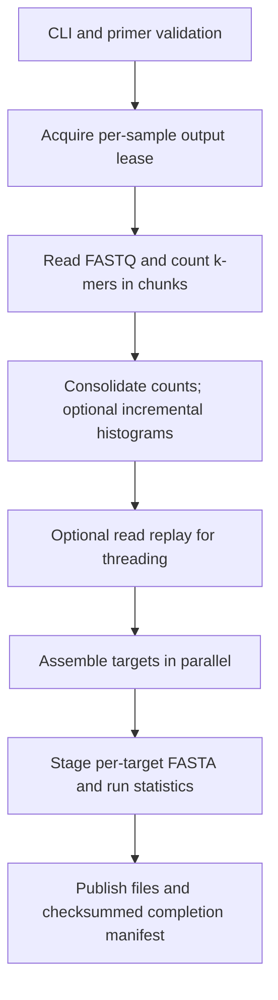

# Sharkmer architecture overview

This describes the implementation released in **v3.2.1**, which is the starting
point for v4. Checked against the source on 2026-11-09. Update this overview
when implementation changes; [PLAN.md](PLAN.md) holds proposed work and gates.
[CONTRIBUTING.md](../CONTRIBUTING.md) describes builds, checks, and releases.

## Pipeline

[`main.rs`](../src/main.rs) orchestrates these stages. Early-exit operations,
including the dry run, finish before creating the output directory. Primer
expansion limits are checked before read ingestion. A shared Rayon pool runs
per-target assembly; FASTA records are written sequentially afterward.

## Code map

| Module | Responsibility |
| --- | --- |
| [`cli.rs`](../src/cli.rs) | Parse arguments, collect panels/primers, validate limits, apply runtime overrides, resolve sample identity, and handle early exits. |
| [`io.rs`](../src/io.rs) | Read local files, stdin, or ENA sources; count selected FASTQ records; finalize chunks; replay reads for optional threading. |
| [`cache.rs`](../src/cache.rs) | Manage owned, checksummed remote-read cache entries and cooperating-user leases. |
| [`kmer/encoding.rs`](../src/kmer/encoding.rs) | Two-bit DNA encoding, canonical k-mers, and invalid-base window breaks. |
| [`kmer/counting.rs`](../src/kmer/counting.rs) | Hash-map count storage, lookup, merging, medians, and lazy filtered views. |
| [`kmer/chunk.rs`](../src/kmer/chunk.rs), [`histogram.rs`](../src/kmer/histogram.rs) | Per-chunk counts and incremental frequency distributions. |
| [`pcr/mod.rs`](../src/pcr/mod.rs) | Per-target threshold sweep, admission, diagnostics, and assembly coordination. |
| [`pcr/primers.rs`](../src/pcr/primers.rs), [`preconfigured.rs`](../src/pcr/preconfigured.rs) | Primer matching and panel loading from embedded YAML, local files, or URLs. |
| [`pcr/graph.rs`](../src/pcr/graph.rs), [`pruning.rs`](../src/pcr/pruning.rs) | Seed/extend target graphs, record repeat markers, remove low-coverage tips and unreachable regions, and annotate coverage ratios. |
| [`pcr/paths.rs`](../src/pcr/paths.rs), [`uncertain.rs`](../src/pcr/uncertain.rs) | Bounded path search, sequence generation/retention, and warning-bearing hypotheses. |
| [`pcr/threading.rs`](../src/pcr/threading.rs), [`bubble.rs`](../src/pcr/bubble.rs) | Optional local read/fragment support and branch preferences. |
| [`stats.rs`](../src/stats.rs) | Parallel target execution, combined FASTA staging, run/target statistics, and summaries. |
| [`output.rs`](../src/output.rs) | Per-sample lease, owned-output verification, staging, completion/failure manifests, and publication. |

## Input and count storage

`io::ingest_reads()` validates FASTQ records and batches sequences into
`Chunk` counters. Local gzip input and remote gzip streams support concatenated
members. Invalid bases break k-mer windows within a read. The source plan
records the selected input sources, paired mode, and read limit for replay.

The read counter uses `u64` keys and `u32` counts. DNA bases use two bits each;
supported k is at most 31. Ingested count keys use the smaller of forward and
reverse-complement encodings. Counts use saturating addition at `u32::MAX`.
The default hash-map backend is ahash; FxHashMap is a separate build feature.
`FilteredKmerCounts` applies minimum-count thresholds during lookup without
copying the underlying table.

**Canonical count keys and oriented identities require care.** `KmerCounts`
also stores directional primer matches through its generic insertion API.
Canonical identity is therefore not a universal invariant of every instance.
Inspect the caller and lookup method before using one as an exact count store.
Separating these roles is part of [#139](https://github.com/caseywdunn/sharkmer/issues/139).

`--chunks 0` currently allocates one internal chunk and still merges it into a
new count table in `consolidate_and_histogram()`. It skips histogram output.
For `--chunks > 0`, counts are merged while updating a running histogram;
snapshots produce `.histo` and `.final.histo` files. Removing redundant
consolidation and per-read allocation from normal sPCR is planned in
[#140](https://github.com/caseywdunn/sharkmer/issues/140). The existing global
count store is in memory; bounded external counting/lookup remains future work.

## Optional read replay

`--read-threading` enables `io::reread_sequences()` after counting when PCR
targets are present. Replay uses the saved source plan. Stdin has no replay
source and falls back to k-mer-only scoring. Remote input can use verified
cache files or require another download.

The current implementation collects replayed `ReadRecord` values in a vector
and shares them across target assemblies. Each target graph maps reads to
contiguous oriented walks and derives edge support, branch links, and paired
links. This is local evidence; whole-product phase and biological repeat count
remain unresolved. Threading alone does not emit `read_support=evaluated`.
Bounded replay and streamed evidence are planned under #145 and #116 in
[PLAN.md](PLAN.md).

## Target assembly and retention

1. Expand supported primer alternatives within checked work limits, find
   matching directional primer k-mers, and seed a target graph. Nodes represent
   oriented `(k-1)`-mers; edges carry observed k-mers and counts.
2. Evaluate decreasing coverage thresholds using fresh seed-graph clones.
   Extend, prune, and evaluate each clone. A connected graph or an invalid
   candidate does not end the sweep; ordinary admission stops at the first
   threshold producing a valid product.
3. Preserve repeat evidence from extension and before pruning, including
   omitted self-loops, cyclic components, and retained collision edges.
   Apply coverage-ratio filtering, node budgets, tip pruning, reachability,
   and path/length/repeat checks. Optional threading supplies branch preferences
   and local support for scoring.
4. Search paths within configured DFS-state, retained-path, length, and
   node-visit limits. Generate sequences, score ordinary candidates, and apply
   their existing edit-distance deduplication. Repeat-rejected candidates
   do not consume the ordinary-product path quota.
5. Retain bounded repeat-uncertain hypotheses with their evidence. This path
   preserves exact distinct sequence identities within its retention limits.
   Search exhaustion, retention truncation, and diagnostic-detail limits are
   reported separately in target statistics.

Normal per-target FASTA combines ordinary records and warning-bearing
hypotheses. `--no-emit-uncertain` excludes the latter. See
[sequence annotations](SEQUENCE_ANNOTATIONS.md) for field meanings, omission
rules, and the v4 interface cleanup. An emitted graph path is an assembly
hypothesis; biological validity requires independent evidence. The
[retention assessment](SEQUENCE_RETENTION_RESULTS.md) records the tested scope
and unresolved questions.

## Publication and measurements

`OutputTransaction::begin()` obtains a per-sample file lease and verifies
previous owned outputs before replacement. FASTA and stats are staged, then
published with a run identity and checksummed manifest. Interrupted or failed
runs cannot present a valid completed transaction. Modified, unowned, and
symlink collisions are preserved and refused. Histogram and graph-dump files
are outside this FASTA/stats transaction.

`stats::RunStats` records source selection, stage timings, count-table capacity,
run completion, and per-target results. Interpret measurements using their
actual scope:

- `n_reads_read` counts FASTQ records read; `n_subreads_ingested` is the legacy
  name for records submitted to counting, rather than invalid-base segments.
- `n_kmers` counts accepted k-mer occurrences, rather than distinct keys.
- `peak_memory_bytes` measures allocator heap usage. Benchmark process RSS is
  a separate measurement when available.
- The integer count-table median is floored for even-sized sets; graph and
  product coverage medians can retain half-count values.

See the [documentation index](README.md) for the release baseline, validation
provenance, and historical investigations. [DESIGN_DECISIONS.md](DESIGN_DECISIONS.md)
preserves earlier reasoning; current v4 requirements live in [PLAN.md](PLAN.md).
