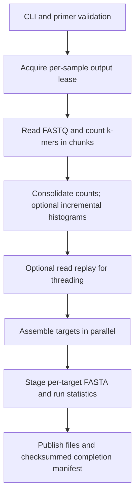

# Sharkmer architecture overview

This describes the **v4.0** implementation and preserves dated development
checkpoints below. Update this overview
when implementation changes; [PLAN.md](PLAN.md) holds proposed work and gates.
[CONTRIBUTING.md](../CONTRIBUTING.md) describes builds, checks, and releases.

The user narrowed the resource contract on 2026-11-16 to bounded application
buffers plus measured process headroom and existing platform safeguards.
Exhaustive networking/runtime allocation ownership is outside v4 scope. The
HTTP accounting experiment is removed; established library calls handle client
internals and errors. Dated checkpoints below retain their historical scope;
use [the current resource boundary](COUNT_STORE_CONTRACTS.md#v4-resource-boundary)
and [PLAN.md](PLAN.md) for release requirements.

V4 adds typed canonical/oriented keys and positioned rolling
extraction in [`kmer/identity.rs`](../src/kmer/identity.rs), an exact count store,
shared resource reservations and fallible assembly access. The existing encoder
collects those windows under the released validation policy. Normal sPCR now
selects exact hybrid counting and uses bounded replay when read threading is
enabled. Explicit incremental counting retains its legacy path. The
[v4 release benchmark](https://github.com/caseywdunn/sharkmer-benchmarks/tree/main/benchmarks/benchmark_results/v4-final-integration-20261117)
records default-path acceptance.
The hidden external-counting candidate now streams bounded sort/merge runs into
a checksummed disk store used directly by PCR. It retains a fixed lookup cache
and charged buffers for concurrent scans. Normal counting uses the disk store
when its table fills.
The hidden parallel candidate keeps disjoint owner tables without consolidation.
Serial and parallel adaptive candidates now transfer accepted counts to bounded
disk storage when their shared table reservations are exhausted.
Exact candidates now capture bounded original-pass replay for requested read
threading. The explicit legacy path retains its source-reopen adapter.
Assembly workers start after counting owners have joined; counting-only runs
skip the assembly pool. The coordinator participates in assembly, keeping
the total OS thread count within the requested allowance.
The hidden `pipeline` candidate overlaps ordered selected-record hashing with
counting through three fixed byte buffers; it preserves the existing digest
format. That candidate failed the full performance gate. The default hybrid
path uses the same roles except at two threads: after the table reaches
16 MiB, it joins the hashing worker, moves the existing table into one count
owner and continues the unfinished hash inline. It copies no global table and
does not reopen input. The handoff passed a hard-limit trial and the integrated
path passed the release's paired comparison and 80-case matrix.

Selected-input hashing uses a fallible SHA-256 wrapper over the provider already
locked for HTTPS. It preserves digest bytes and rejects lengths outside the
SHA-256 representation before provider finalization. An independently audited
native trial supports the provider change. See the [contracts](COUNT_STORE_CONTRACTS.md)
for verification scope and current evidence.

Exact frontends preflight the count/replay descriptor pool against the Unix
soft limit, Linux startup descriptor census and additional headroom. Performed
observations and the effective allowance appear in stats. This controls shared
temporary-file ownership; individual input/output/library descriptors and
whole-process accounting remain separate migration work.

Exact remote cache misses now use the same bounded FASTQ arena and shared
input ledger as counting. Cache normalization and selected-record/completion
semantics remain unchanged. Full checks pass 507 Rust tests per hasher and
225 Python tests, including HTTP/cache/count/replay integration. Native and
retained evidence now pass. Those trials scope record buffers; later cache
storage ownership is described below. See the
[cache record-buffer contract](COUNT_STORE_CONTRACTS.md#remote-cache-miss-record-buffers).

Cache sidecar decoding/emission now also owns bounded input, audited YAML
workspace and surviving strings under the shared memory ledger. Closed
sidecar temporary bytes remain charged through cache-directory sync. The
cache-metadata checkpoint (local evidence: `benchmarks/benchmark_results/v4-cache-metadata-20261114/README.md`)
passes 560 Rust tests per hasher, 225 Python tests and 80 cache/HTTP component
tests under actual 64-descriptor/512 MiB limits. The later
cache-data/workspace-I/O checkpoint (local evidence: `benchmarks/benchmark_results/v4-cache-data-20261114/README.md`)
also owns compressed temporary bytes through gzip/buffer finalization and
durable publication. It passes 562 Rust tests per hasher, 225 Python tests,
84 hard-limit cache/HTTP component tests and 544 independently audited native
workspace I/O cases (1,360 invocations). Exact source/archive and raw-payload
retention passes. The
registered cache-recovery checkpoint (local evidence: `benchmarks/benchmark_results/v4-cache-recovery-20261114/README.md`)
adds same-filesystem ownership, fixed checksummed generation receipts, retained
backups and repeatable cold restoration. It passes 570 Rust tests per hasher,
225 Python tests, 100 hard-limit cache/HTTP component tests and 544 independently
audited native I/O/SIGTERM cases (1,488 invocations, 212 actual SIGTERMs).
Retained verification checks three source archives and 16,196 raw payloads.
The application FASTQ codec/buffer checkpoint (local evidence: `benchmarks/benchmark_results/v4-codec-20261114/README.md`)
also preadmits source buffers, gzip state and optional-header overlap, and cache
compression through final flushing. Source-audited bounds and isolated heap
observations agree; all allocations release. Full checks pass 576 Rust tests
per hasher and 225 Python tests, 112 hard-limit component tests and 544 native
cache fault cases, with independent audits and source/dependency/raw retention.
HTTP/TLS/content-encoding, preprocessing and complete process/physical-filesystem
ownership remain open; no whole-system power-loss claim follows.

ENA metadata ownership (local evidence: `benchmarks/benchmark_results/v4-ena-20261114/README.md`)
now prepares the count ledger before sample resolution and reuses it for the
bounded response body, first-row URL/scientific-name models and sample spelling.
The original body limit, lossy UTF-8, URL order and sample names are preserved.
Dry runs retain their early-exit behavior with metadata-only preparation.
Full checks pass 583 Rust tests per hasher and 225 Python tests, 126 hard-limit
component tests and 544 native workspace I/O/retry cases, with independent
source/dependency/raw-payload retention. HTTP/TLS/content-encoding and earlier
panel/CLI preprocessing remain separate open owners.

Automatic HTTP gzip ownership (local evidence: `benchmarks/benchmark_results/v4-http-codec-20261114/README.md`)
now admits eager content decoding before ENA/read requests, separately from
application FASTQ gzip, on the original ledger. Readers and retained HTTP
errors keep the reservation until library destruction. Full checks pass 589
Rust tests per hasher and 225 Python tests, all 138 hard-limit component tests
and 544 independently audited cache I/O/SIGTERM cases. Source/dependency and
15,447 raw payload checks pass retention. Request/header/TLS and earlier
panel/CLI preprocessing remain open owners.

Workspace namespace identity (local evidence: `benchmarks/benchmark_results/v4-workspace-identity-20261114/README.md`)
now validates original parent storage before accepting a missing temporary
child or cleaning private data. NFS uses kernel object handles, preserving
shared-storage recovery across alternate server addresses. Local storage also
binds boot/device/inode. Full checks pass 595 Rust tests per hasher and 225
Python tests, 168 hard-limit component tests, 544 native I/O/retry cases and
32 independently audited two-node cases (96 invocations, 32 actual SIGTERMs).
Five source archives, 94 dependency files and all 28,664 raw payloads pass
retention.

Markerless development-journal recovery (local evidence: `benchmarks/benchmark_results/v4-legacy-journal-20261114/README.md`)
now preplans and admits the validated private scope, then persists a zero-byte
owner and accepted-manifest anchor before deleting the journal. A fresh startup
can finish cleanup after interruption without treating unmarked foreign data as
owned. Full checks pass 597 Rust tests per hasher and 225 Python tests, 346
hard-limit component tests and 1,088 independently audited native fault cases
(2,184 invocations, 276 actual SIGTERMs). Three source archives, 94 dependency
files and all 30,344 raw payloads pass retention. These journals came from
earlier unreleased v4 builds; v3.2.1 did not emit them. Broader
physical/descriptor and library/preprocessing ownership remain open.

Panel configuration ownership (local evidence: `benchmarks/benchmark_results/v4-panel-preprocessing-20261114/README.md`)
now prepares the original ledger before collecting primers, admitting input,
parser/model storage, derived names, inline settings and validation reports.
Unused root metadata and superseded arrays release before counting. Linux
previews observe inherited limits while ignoring unused count settings. The
decoder-error follow-up (local evidence: `benchmarks/benchmark_results/v4-yaml-error-lifetime-20261114/README.md`)
keeps the loader allowance with retained library errors in configuration and
historical manifest/journal readers; typed resource errors remain intact.
Current checks pass 609 Rust tests per hasher, 225 Python tests, 428 hard-limit
component executions and 26 independently audited native cases/48 invocations.
Source, compiler/dependency and new/reused raw evidence pass retention.
Raw argument/clap, other validation/library/error/transport owners and broader
process/filesystem accounting remain open.

Normal sPCR enables graph-buffer controls that reserve target admission on the
count/graph ledger. Owned primary arrays, node maps and extension/pruning/repeat
workspaces share a child ceiling and reserve before growth or cloning,
including overlapping old and replacement allocations. Compact indexed flags
preserve stable graph IDs, holes and component membership. Encoded primer
levels, directional candidate tables and seed/count buffers now use the same
ceiling. A bounded heap preserves mismatch/count/key selection without first
collecting all matching candidates. Path/evidence and retained-result
allocations still require migration;
[the ownership inventory](COUNT_STORE_CONTRACTS.md) defines that remaining scope.

## Pipeline

[`main.rs`](../src/main.rs) orchestrates these stages. Early-exit operations,
including the dry run, finish before creating the output directory. Primer
expansion limits are checked before read ingestion. A shared Rayon pool runs
per-target assembly; FASTA records are written sequentially afterward.

## Code map

| Module | Responsibility |
| --- | --- |
| [`cli.rs`](../src/cli.rs) | Parse arguments, collect panels/primers, validate limits, apply runtime overrides, resolve sample identity, and handle early exits. |
| [`io.rs`](../src/io.rs), [`fastq.rs`](../src/fastq.rs) | Acquire selected FASTQ records; retain legacy chunking or exercise direct exact counting and bounded reusable parsing; replay reads for optional threading. |
| [`io/ena.rs`](../src/io/ena.rs) | Own bounded ENA body/model/sample allocations and preserve first-row, lossy-decoding and derived-name semantics. |
| [`http.rs`](../src/http.rs), [`codec.rs`](../src/codec.rs) | Delegate remote GET/content decoding to ureq, preserving panel timeouts and normal error propagation. Application FASTQ buffering/gzip retains its own limits. The minimal chunk-framing patch avoids a reproduced unbounded framing allocation. Client/runtime internals use headroom and platform limits; exhaustive networking accounting is outside v4. See [HTTP scope](HTTP_WORKSPACE.md). |
| [`input_identity.rs`](../src/input_identity.rs), [`input_identity/digest.rs`](../src/input_identity/digest.rs) | Preserve selected-record SHA-256 framing through bounded worker buffers, continuation across worker roles and fallible length checks. |
| [`cache.rs`](../src/cache.rs) | Manage owned, checksummed remote-read cache entries and cooperating-user leases. |
| [`kmer/encoding.rs`](../src/kmer/encoding.rs) | Two-bit DNA encoding, canonical k-mers, and invalid-base window breaks. |
| [`kmer/counting.rs`](../src/kmer/counting.rs) | Legacy u32 hash-map storage, lookup and incremental merging. |
| [`kmer/access.rs`](../src/kmer/access.rs), [`primers.rs`](../src/kmer/primers.rs) | Borrowed fallible assembly access and separate directional u64 primer candidates. |
| [`kmer/store.rs`](../src/kmer/store.rs), [`budget.rs`](../src/kmer/budget.rs) | Exact u64 store candidate and shared RAM, disk-byte and count/replay descriptor reservations; whole-run integration remains open. |
| [`kmer/external.rs`](../src/kmer/external.rs), [`sorted_file.rs`](../src/kmer/sorted_file.rs) | Bounded external sort/merge producer, checksummed full-key disk lookup and independent charged scan buffers; hidden development selector only. |
| [`kmer/parallel.rs`](../src/kmer/parallel.rs) | Bounded reusable coordinator/owner queues, disjoint exact memory/disk shards and joined finalization without consolidation. |
| [`kmer/adaptive.rs`](../src/kmer/adaptive.rs) | Lossless transfer of an accepted weighted memory prefix into bounded external counting; serial and per-owner development paths. |
| [`kmer/packed.rs`](../src/kmer/packed.rs) | Experimental full-key byte columns and exact u64 counts, charged resize peaks and move finalization; native performance gates remain required. |
| [`replay.rs`](../src/replay.rs) | Original-pass selected-record spool with checked framing, original FASTQ fields, count-pass identity and bounded visitors. |
| [`input_identity.rs`](../src/input_identity.rs) | Ordered selected-record hashing worker with three charged reusable buffers, drained and joined before count/replay publication. |
| [`kmer/temporary.rs`](../src/kmer/temporary.rs) | Owned file extents and descriptors, reservations before opening/writing and confirmed cleanup for external-count/replay development. |
| [`kmer/chunk.rs`](../src/kmer/chunk.rs), [`histogram.rs`](../src/kmer/histogram.rs) | Per-chunk counts and incremental frequency distributions. |
| [`pcr/mod.rs`](../src/pcr/mod.rs) | Per-target threshold sweep, admission, diagnostics, and assembly coordination. |
| [`pcr/primers.rs`](../src/pcr/primers.rs), [`preconfigured.rs`](../src/pcr/preconfigured.rs) | Primer matching and panel loading from embedded YAML, local files, or URLs. |
| [`pcr/graph.rs`](../src/pcr/graph.rs), [`pruning.rs`](../src/pcr/pruning.rs) | Seed/extend target graphs, record repeat markers, remove low-coverage tips and unreachable regions, and annotate coverage ratios. |
| [`pcr/paths.rs`](../src/pcr/paths.rs), [`uncertain.rs`](../src/pcr/uncertain.rs) | Bounded path search, sequence generation/retention, and warning-bearing hypotheses. |
| [`pcr/threading.rs`](../src/pcr/threading.rs), [`bubble.rs`](../src/pcr/bubble.rs) | Optional local read/fragment support and branch preferences. |
| [`stats.rs`](../src/stats.rs) | Parallel target execution, combined FASTA staging, run/target statistics, and summaries. |
| [`output/workspace.rs`](../src/output/workspace.rs), [`identity.rs`](../src/output/workspace/identity.rs) | Register external count/replay roots, verify parent object identity across retries and reclaim only owned children. The bounded Linux NFS syscall adapter is isolated in [`handle.rs`](../src/output/workspace/identity/handle.rs). |
| [`output.rs`](../src/output.rs) | Per-sample lease, owned-output verification, staging, completion/failure manifests, and publication. |

## Input and count storage

`io::ingest_reads()` validates FASTQ records and batches sequences into
`Chunk` counters. Local gzip input and remote gzip streams support concatenated
members. Invalid bases break k-mer windows within a read. The source plan
records the selected input sources, paired mode, and read limit for replay.

Normal sPCR uses exact `u64` keys and counts, with checked overflow. DNA bases
use two bits each; supported k is at most 31. Ingested count keys use the
smaller of forward and reverse-complement encodings. The retained legacy
incremental counter uses `u32` counts and saturates at `u32::MAX`.
The default hash-map backend is ahash; FxHashMap is a separate build feature.
`FilteredKmerCounts` borrows either this legacy table or a finalized exact store.
It applies thresholds without copying global counts, visits entries with
propagated errors and provides fallible lookup to graph construction. The legacy
adapter retains its original count precision; it does not make saturated counts
exact. Primer matches use a separate `PrimerKmers` collection with directional
identities and checked u64 abundance. Graph edges, thresholds and path count
metrics also retain u64 values. Normal CLI ingestion now uses the hybrid exact
counter, complete native assembly and optional bounded replay. Integrated
acceptance remains gated under [#140](https://github.com/caseywdunn/sharkmer/issues/140).

Normal `--chunks 0` counting moves its finalized exact store into assembly
without chunk consolidation. Its adaptive owner tables spill into bounded
disk stores when table reservations are exhausted; PCR queries those stores
directly. Explicit legacy `--chunks 0` still merges a sole internal chunk.
For `--chunks > 0`, legacy counts merge while updating a running histogram;
snapshots produce `.histo` and `.final.histo`. Whole-run resource acceptance
and remaining ownership are tracked in
[the contracts](COUNT_STORE_CONTRACTS.md).

A hidden development selector, `--count-backend memory`, exercises the direct
exact path for `--chunks 0`. It uses one reusable bounded FASTQ arena per reader,
streams windows into the exact u64 builder, records selected-read identity, and
moves the finalized table into assembly without chunk consolidation. Separate
table/arena limits account for owned buffers; they are not a complete process
RAM bound. Explicit developer selectors preserve their independent controls.
See [COUNT_STORE_CONTRACTS.md](COUNT_STORE_CONTRACTS.md) for the precise current
scope, verification fingerprints and remaining resource/replay requirements.
After the custom linear-probing table failed the frozen performance gates,
the development candidate uses a pinned Hashbrown table with full key/count
precision, control-byte accounting and concrete memory-scan dispatch. Default
acceptance for the integrated normal path remains pending its own full paired
measurement, despite the isolated candidate's passing comparison.

## Optional read replay

`--read-threading` requests replay when PCR targets are present. Exact counters,
including the normal path, capture selected original records during ingestion, including stdin,
and validate a framed, checksummed file against the count pass's input identity.
Each target streams records through a bounded visitor; paired mapping retains
one pending fragment. Original identifiers, qualities, source/mate identity,
sequence positions and N gaps survive this spool. Optional `read_replay` stats
describe actual replay storage and owned buffers.

The explicit legacy backend still calls `io::reread_sequences()` to collect a
read vector from local/cache files or another remote download. Its stdin path
still falls back to k-mer-only scoring. Integrated production acceptance and
remaining whole-run resource ownership stay open under #139–#145.

Each target graph maps reads to contiguous oriented walks and derives edge
support, branch links and paired links. Development graph/evidence buffers now
share the target allowance, separately from the replay-buffer bound. This is
local evidence; whole-product
phase and biological repeat count remain unresolved. Threading alone does not
emit `read_support=evaluated`. Future evidence scope remains under #116 in
[PLAN.md](PLAN.md).

## Target assembly and retention

1. Expand supported primer alternatives within checked work limits, find
   matching directional primer k-mers, and seed a target graph. Nodes represent
   oriented `(k-1)`-mers; edges carry observed k-mers and counts.
2. Evaluate decreasing coverage thresholds using fresh seed-graph clones.
   Extend, prune, and evaluate each clone. A connected graph or an invalid
   candidate does not end the sweep; ordinary admission stops at the first
   threshold producing a valid product.
3. Preserve repeat evidence from extension and before pruning, including
   omitted self-loops, cyclic components, and retained collision edges.
   Apply coverage-ratio filtering, node budgets, tip pruning, reachability,
   and path/length/repeat checks. Optional threading supplies branch preferences
   and local support for scoring.
4. Search paths within configured DFS-state, retained-path, length, and
   node-visit limits. Generate sequences, score ordinary candidates, and apply
   their existing edit-distance deduplication. Repeat-rejected candidates
   do not consume the ordinary-product path quota.
5. Retain bounded repeat-uncertain hypotheses with their evidence. This path
   preserves exact distinct sequence identities within its retention limits.
   Search exhaustion, retention truncation, and diagnostic-detail limits are
   reported separately in target statistics.

The exact path prepares one numeric counter layout and shared ledger after
validation/dry-run handling, before creating output resources. Counter tables,
workers and temporary paths start only when ingestion consumes that plan.
New-generation transaction paths, labels, staged receipts and digests use the
same parent ledger. Manifest and generated recovery-journal views borrow those
owners, with audited YAML workspace reserved before temporary-file creation.
Prior-output cleanup paths and duplicate tables, sorted borrowed recovery
receipt indexes and the restore plan also use parent reservations. Recovery
admits every managed destination and restore path before public mutation,
preserving its lexical restore order. Backup and restore copies share one
64 KiB parent-owned buffer, admitted before backup creation or public recovery
mutation and released after the final synced copy. The unbudgeted path keeps
its existing standard-library copy. Historical input and retained typed models
now have parent reservations: Serde seeds admit text and receipt arrays before
copying, including aliases. Parsed models keep their guards through destruction.
The pinned loader also reserves scanner/events/anchors and tag expansion before
decoding, with a guard through library cleanup. Its boundary scan is conservative
for scalar text. Returned error reporting, tempfile-library metadata and other
process overhead still require ownership.
See historical input/model evidence and the loader probe (local evidence: `benchmarks/benchmark_results/v4-parsed-metadata-20261113/README.md`) and the
verification/recovery workspace evidence (local evidence: `benchmarks/benchmark_results/v4-recovery-workspaces-20261113/README.md`).
See the publication metadata evidence and limits (local evidence: `benchmarks/benchmark_results/v4-publication-metadata-20261113/README.md`).
The count-input peak is measured from counter construction through finalization;
completed startup workspace affects the lifetime peak, not that phase metric.
The earlier descriptor census records actual open files and separately allows
for the planned output lease, keeping the former temporary-file cap when
the census is available and preserving the 16-slot additional allowance. See the
startup-ledger verification (local evidence: `benchmarks/benchmark_results/v4-startup-ledger-20261113/README.md`).

The development target allowance covers primary graph/lookup buffers,
extension/pruning/repeat and primer workspaces, DFS state and candidate paths,
scratch used for path measurements, read threading and bubble resolution.
The extension lookup drops before later assembly stages. Ordinary sequence
records and annotation identifiers use separate run-level ownership, releasing
target admission before collected products are published. Renumbering moves
sequence storage, and publication writes borrowed FASTA fields. Diagnostic
sequence/hash/marker buffers, warning products and source copies also use the
parent run ledger; hidden diagnostic copies can refuse allocation explicitly.
Fixed labels borrow static text, and warning numbering still follows full
oriented sequence order. Stats strings, length arrays and aggregate result
vectors also retain parent guards; indexed parallel output reserves before
target callbacks. A borrowed Serde preflight also reserves the pinned YAML
emitter buffers, scalar copies and depth storage before staging stats; the
workspace guard outlives emitter cleanup. See the
[serializer allocation model](YAML_WORKSPACE.md). Deduplication also reserves
the pinned edit-distance library's two scratch arrays before each comparison,
using the result owner's parent ledger and class. Distances, ranking and
retention order are unchanged. Other library/process and publication resources
still require accounting.
These controls are enabled for normal sPCR. Their integrated acceptance remains
open; they do not establish a portable whole-run RAM guarantee. See the
stats metadata verification (local evidence: `benchmarks/benchmark_results/v4-stats-metadata-20261113/README.md`),
YAML workspace verification (local evidence: `benchmarks/benchmark_results/v4-yaml-workspace-20261113/README.md`),
deduplication workspace verification (local evidence: `benchmarks/benchmark_results/v4-dedup-workspace-20261113/README.md`)
and [remaining ownership contracts](COUNT_STORE_CONTRACTS.md).

A Linux process address-space safeguard is now installed for normal sPCR
before panel/ENA decoding; explicit positive environment overrides apply before
CLI decoding. It preserves stricter inherited limits and reports only performed
observations. The preceding optional-control checkpoint's native cap/refusal
matrix and self-capped million-read trial pass. Integrated default checks are
pending. See the
[cap contract and limits](COUNT_STORE_CONTRACTS.md#optional-process-address-space-safeguard)
and verification (local evidence: `benchmarks/benchmark_results/v4-process-memory-20261113/README.md`).

Normal per-target FASTA combines ordinary records and warning-bearing
hypotheses. `--no-emit-uncertain` excludes the latter. See
[sequence annotations](SEQUENCE_ANNOTATIONS.md) for field meanings, omission
rules, and the v4 interface cleanup. An emitted graph path is an assembly
hypothesis; biological validity requires independent evidence. The
[retention assessment](SEQUENCE_RETENTION_RESULTS.md) records the tested scope
and unresolved questions.

## Publication and measurements

`OutputTransaction::begin()` obtains a per-sample file lease and verifies
previous owned outputs before replacement. FASTA and stats are staged, then
published with a run identity and checksummed manifest. Interrupted or failed
runs cannot present a valid completed transaction. Modified, unowned, and
symlink collisions are preserved and refused. Completed outputs stay in place during a rerun's analysis; a failed attempt
gets a separate hidden receipt. Before replacement, independent backup copies
and a synced recovery receipt protect the previous generation. Recovery under
the sample lock restores incomplete publication or accepts a completed
replacement, refusing conflicting edits and retaining backups when recovery
cannot finish. Full quality checks and independent native EIO/ENOSPC/SIGTERM
verification pass. See the recovery evidence and limits (local evidence: `benchmarks/benchmark_results/v4-publication-recovery-20261113/README.md`).
Staged FASTA/stats bytes and new recovery-backup copies now reserve shared
temporary-disk space before writing. In-process accepted cleanup verifies
captured journal/manifest hashes and the typed backup/output receipts without
decoding its own YAML; historical restart recovery retains full parsing.
The staged-byte checkpoint (local evidence: `benchmarks/benchmark_results/v4-output-disk-20261113/README.md`)
passes retained verification; the
backup/cleanup checkpoint (local evidence: `benchmarks/benchmark_results/v4-backup-disk-20261113/README.md`)
passes corrected full/native and retained verification. The
restoration-copy checkpoint (local evidence: `benchmarks/benchmark_results/v4-restore-disk-20261113/README.md`)
also passes disk admission, private-copy integrity, close-before-unlink and
controlled failure/retry checks. Interrupted restoration cleanup also passes
actual SIGTERM recovery (local evidence: `benchmarks/benchmark_results/v4-restore-signals-20261113/README.md`):
new copies stay within receipted staging and leave no orphans.
Existing-storage adoption (local evidence: `benchmarks/benchmark_results/v4-recovery-completion-20261113/README.md`)
now charges the interrupted private tree, journal and unaccepted public
payloads together with planned restoration copies before mutation. Unix inode
identities avoid charging hard-link aliases twice; in-process recovery credits
its live payload owners. The initial full local checks pass, but the larger
native trial exposed directory cleanup leaving private files. Corrected
cleanup preplans each removal before mutation and counts restored old public
files until manifest acceptance. Corrected full checks and native compatibility/
fault/SIGTERM, large quota and completed-replacement audits pass. Combined
retained verification also passes, with the initial failure and its exact
source preserved separately.
New manifest/journal writes now use the same charged, closed writer, with a
separate journal guard and matching recovery credit. Count-disk peaks measure
only the counting/finalization phase and include its live baseline, preserving
the run's lifetime peak separately. The
metadata checkpoint (local evidence: `benchmarks/benchmark_results/v4-metadata-disk-20261113/README.md`)
passes full and independent native checks plus combined retained verification.
The staging preparation checkpoint (local evidence: `benchmarks/benchmark_results/v4-preparation-20261113/README.md`)
passes frozen-source SIGTERM and retained checks. The
registered workspace candidate (local evidence: `benchmarks/benchmark_results/v4-registered-workspace-20261113/README.md`)
now records a canonical private count/replay root before creating it, adopts
its extents with staged data before recovery mutation, and keeps ownership
records until payload cleanup. Live commit closes the root using its retained
paths; unused replay also closes before commit. Frozen-source full/native signal/quota checks and retention pass. Later
receipt guards refuse incomplete replacements missing their recovery journal;
targeted verification passes, with final integration still pending. Whole-run resource completion and final
integration remain open.
Histogram and graph-dump files are outside this FASTA/stats transaction.

`stats::RunStats` records source selection, stage timings, count-table capacity,
run completion, and per-target results. Interpret measurements using their
actual scope:

- `n_reads_read` counts FASTQ records read; `n_subreads_ingested` is the legacy
  name for records submitted to counting, rather than invalid-base segments.
- `n_kmers` counts accepted k-mer occurrences, rather than distinct keys.
- `peak_memory_bytes` measures allocator heap usage. Benchmark process RSS is
  a separate measurement when available.
- The integer count-table median is floored for even-sized sets; graph and
  product coverage medians can retain half-count values.

See the [documentation index](README.md) for the release baseline, validation
provenance, and historical investigations. [DESIGN_DECISIONS.md](DESIGN_DECISIONS.md)
preserves earlier reasoning; current v4 requirements live in [PLAN.md](PLAN.md).
